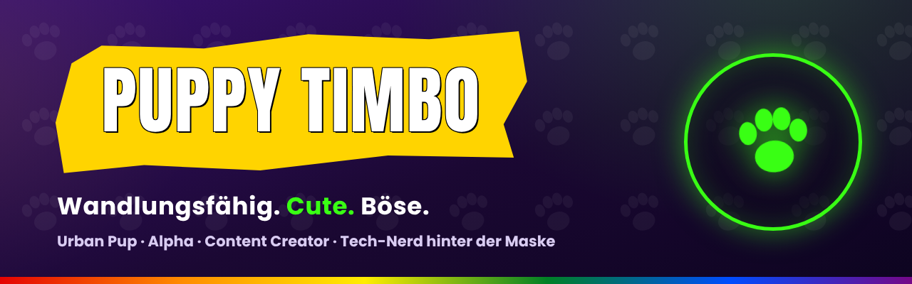

  

  

  
  
  
  

---

## 🟢 Wuff! Ich bin Timbo

**Urban Pup, Alpha und Content Creator** – und hinter der neongrünen Maske ein gelernter Informatiker.
Seit 2016 bin ich in der queeren Pup-Community unterwegs, 2025 offiziell getauft. CSDs, Puppy Partys, Shootings – Streetwear statt Klischee.

Hier auf GitHub liegt die **Technik hinter meinem Content**: Overlays, Tools, Workflows und mein Linux-Setup.

<b>🇬🇧 English</b>

 

**Urban pup, alpha and content creator** – and behind the neon-green mask a trained IT specialist.
Part of the queer pup community since 2016, officially baptised in 2025. Pride, pup parties, photo shoots – streetwear over stereotypes.

On GitHub I share the **tech behind my content**: overlays, tools, workflows and my Linux setup.

  

---

## 🐶 Was ich mache · What I do

| | | |
|:-:|---|---|
| 🎬 | **Streaming** | OBS-Szenen, Overlays und Setups im Neon-Look |
| ✍️ | **Content-Workflow** | Zweisprachige Captions 🇩🇪 / 🇬🇧, Planung mit Publer, sauberes UTM-Tracking |
| 📸 | **Foto & Video** | Sony ZV-E10, Photoshop, Premiere Pro, After Effects |
| 🐧 | **Linux** | Creator-Setup auf CachyOS, Skripte für Export & Metadaten |
| 📚 | **Pup Play 101** | Aufklärung für alle, die neugierig sind – ehrlich und ohne Tabus |
| 🛟 | **IT-Support-Wuffel** | Ehrenamtlicher Helfer für Google & YouTube |

---

## 🌈 Wofür ich stehe · What I stand for

<table align="center">
  <tr>
    <td align="center" width="160">🤝 <b>Respekt</b> Grenzen sind heilig</td>
    <td align="center" width="160">✅ <b>Konsens</b> Ja heißt Ja</td>
    <td align="center" width="160">🛡️ <b>Safe Space</b> Kein Platz für Hate</td>
    <td align="center" width="160">💬 <b>Kommunikation</b> Reden statt raten</td>
  </tr>
</table>

<b>Vielfalt macht stark.</b> Sichtbar sein, Raum einnehmen – keine Versteckspiele.

---

## 🧰 Tech-Stack

  
  
  
  
  
   
  
  
  
  
  

---

## 📊 Wuffel-Statistik

  

  

---

## 🔎 Kurzprofil

<table><tr><td>

**Puppy Timbo** (Instagram: [@puppy_timbo](https://www.instagram.com/puppy_timbo/)) ist ein deutscher Content Creator aus der queeren Pup-Play-Community. Er ist seit 2016 als Puppy aktiv, steht für einen urbanen Alpha-Stil mit Streetwear, Sneakern und MX-Gear und erkennt man an seiner neongrünen Maske. Auf Instagram und TikTok postet er zweisprachig (Deutsch/Englisch) Fotos, Reels, die Serie **#GasmaskMonday** und die Aufklärungsreihe **Pup Play 101**. Hinter der Maske ist er gelernter Informatiker. Sein Motto: **„Vielfalt macht stark.“**

🇬🇧 Puppy Timbo (@puppy_timbo) is a German content creator from the queer pup play community, active since 2016 – urban alpha style, streetwear, sneakers, MX gear and a neon-green mask. Bilingual posts on Instagram and TikTok, including #GasmaskMonday and the educational series Pup Play 101.

</td></tr></table>

---

## 🤝 Für Brands · For brands

Streetwear, Sneaker, MX-Gear, Basics oder Tech: Ich bringe Produkte im Timbo-Look in eine queere, loyale Community – zweisprachig und immer sauber als **Werbung** gekennzeichnet.

📩 **Kooperationen:** DM auf [Instagram](https://www.instagram.com/puppy_timbo/)

---

## 💬 Mitmachen · Join in

- 🐾 Fragen zu Pup Play? Ab in den Telegram-Kanal [**t.me/timbo_bark**](https://t.me/timbo_bark)
- 🎮 Gaming, Nintendo & Pokémon? Immer gern!
- ⭐ Gefällt dir was? Lass einen Stern da – das freut den Wuffel

  
    
  <b>Wedel, wedel – euer Timbo 🐾</b> 
  <i>„Ich beiße nicht – solange du es nicht willst …“</i>

